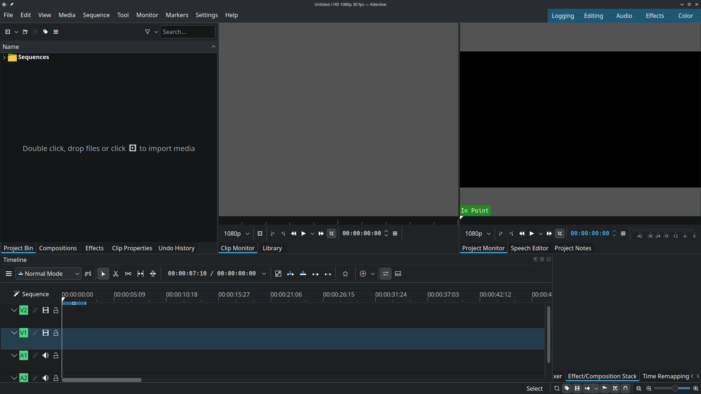
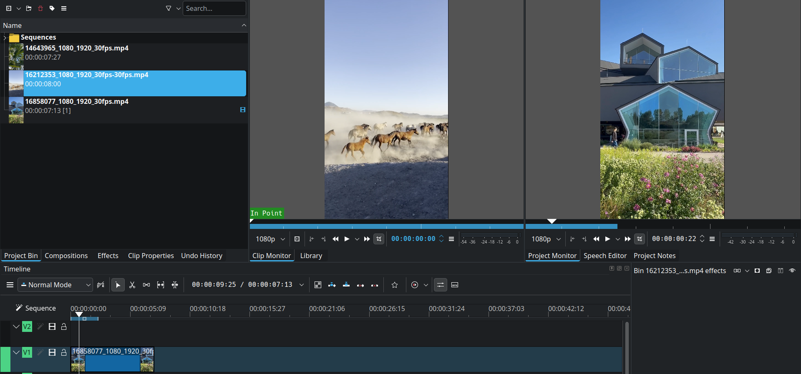
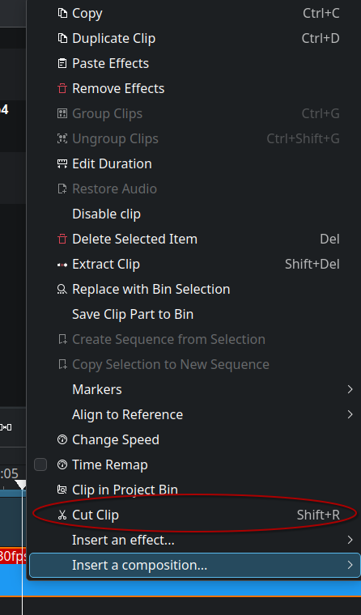
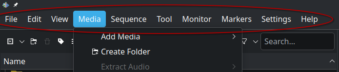
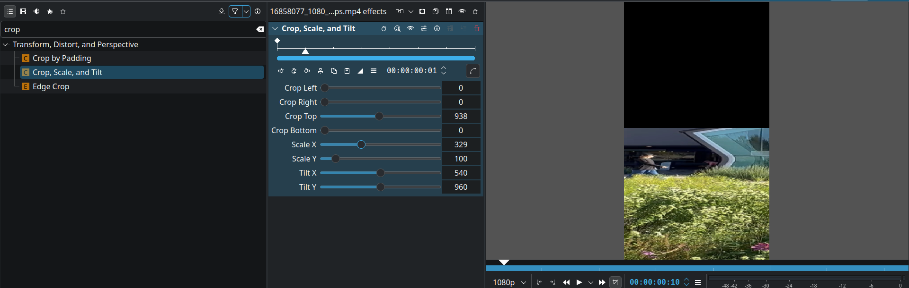

# Learning to Edit a Video with Kdenlive

I've made a few very simple videos for school before using very simple editing software, but I've always wanted to learn some more advanced editing skills than just adding cuts to a video. So for this journal I've decided to explore the Kdenlive video editor and see how to use various editing features of the software, such as efficiently splicing the video and cropping the video. To test these features I need some videos which I downloaded from pexels.com.

To begin, I opened up Kdenlive and saw only a few buttons. The starting menu was very minimal due to it not having many interactables, images, or text which allowed me to quickly scan the menu and find the “New Project” button I needed to press. Next I selected my video format of 1080p 30fps and I was presented with this huge screen full of interactable icons and empty windows.

There are a few things I recognize and many things I don’t understand at all. Kdenlive follows conventions, also known as common practices, for video editing software when it comes to the video and audio tracks in the bottom left of the screen. However, the labels V1 and A1 are not very clear. I think increasing the size of the labels and writing “Video 1” and “Audio 1” in them would make things clearer for first time editors. 

From past experience I also recognize the window in the top left is the area where you drop and store your raw videos. The text inside that window makes it very clear that my mental model of how I expect importing media to work matches with the conceptual model of how the program actually works. I dropped my 3 mp4 files into the window and after a slight delay the program imported them and they were clearly visible. I dragged and dropped a video to the V1 track and it displayed on the window in the top right. The top center window is still empty. It only shows something once I click on one of the videos in the import area. Now both windows are occupied with videos

It seems like Kdenlive breaks from conventions here. I have never seen a separate window just for the import video preview. I don’t see the point of this as you can easily just drag a video into the video track and view it there, but perhaps this is beneficial for more advanced workflows. With more complicated software sometimes designers have to sacrifice some simplicity to allow more advanced and powerful features. Since Kdenlive was likely designed for actual editors who need advanced tools rather than people just learning to edit, it makes sense not everything is perfectly clear for a beginner.

I wanted to remove the import video preview window, so I looked at the different icons around it. None of those icons allowed me to delete it. Out of pure luck, I pressed the right click button and an X button appeared in the top right of the window and I clicked on it and successfully closed the window. I think the designers made this action overly complicated. A simple small X button in the top right in the unused grey area would make it far easier for users to learn how to close these windows.

## Cutting the video

Now with that unneeded window out of the way, I felt confident to start exploring some video editing features. Perhaps the most important feature editing software provides is the ability to cut videos. And thankfully here video editing works just like every other editor I’ve used. Simply drag your line to where you want to splice the video and press a hot key. I didn’t know the hotkey for cutting here, so I just pressed right click and it presented me with many helpful options and the keybinds for each. 

After a quick scan I found the cut button, and the hotkey for it. I made a cut which cut the video into two videos. I then made another cut in the second video so I now have 3 videos on the V1 track. I can now delete the video in the middle by right clicking on it and pressing the delete button. After deleting the middle video I drag and drop the rightmost video to the left to remove the gap that was just created. Having to drag and drop the video is error prone though, so I wondered if there was a better way. After a bit of fiddling around I found the button below delete which was called “Extract Clip”. Pressing this button deletes the video and merges the nearest videos to fill the gap. It even comes with a hotkey which is very convenient. But I don’t think the label “Extract Clip” communicates what happens very well. I think naming it “Delete Clip and Merge” would make things far clearer to the user.

## Cropping the video

The next fundamental editing operation I wanted to try was cropping the screen, which is something I’ve never done before. Unsure where to start, I hovered over the many icons on the screen. There are several icons I recognized, such as the play and pause icons. These common icons are clear signifiers, making their affordances, or clues that signal to the user how to interact with something, very evident. 

After hovering over every icon I couldn’t find anything related to cropping the video, so I decided to try the different buttons near the top that each have dropdowns when you click on them. 

There were several useful options in the dropdowns, but I found no obvious buttons allowing me to crop the video. After trying to interact with all the interactables and still not finding what I needed, I felt like I had no other choice but to look up the answer.

After looking it up online I found out I have to go to the view tab in the top left, then click the “Effects” and “Effects/Composition Stack” buttons. Doing this opened up two windows, one for applying effects to clips by dragging and dropping those different effects onto clips, and the other for adjusting the details of those effects. 

After playing around with the sliders I finally managed to crop my video like I wanted to. I also scaled it horizontally to make my changes more evident. The steps for this workflow were not clear at first, but now that I know there is an effects window and you just need to drag and drop those effects to a clip, I feel confident applying other effects in the future. There are so many effects that they can’t all just be icons, so it makes sense the designers would have a separate and toggleable window for all the different effects.

I feel like I’ve explored enough features to successfully edit a simple video, so now would be a great time to end this journal entry. Overall, I feel like Kdenlive is a great piece of software. It is simple enough for new users to do some basic editing, but presents the user with enough advanced features for it to be useful for more professional editing as well.

